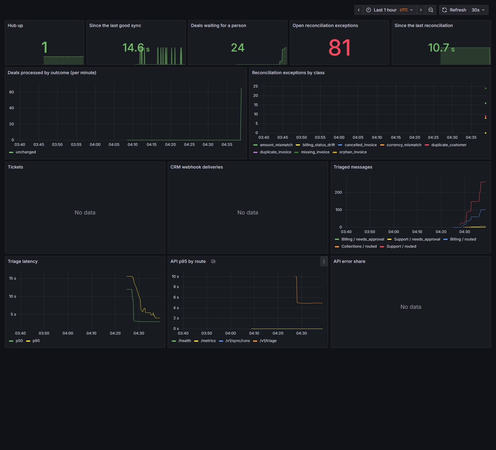

# finops-integration-hub

[](https://github.com/Tajaddin/finops-integration-hub/actions/workflows/ci.yml)

A finance-operations integration hub. When a deal is won in the **CRM** (EspoCRM, or Salesforce through an
adapter), the hub creates and posts the invoice in the **ERP** (Odoo 19) exactly once, writes the invoice number and
payment status back to the CRM, reconciles the two systems every night, and opens one **helpdesk ticket** (Zammad,
Jira or GitHub Issues) per mismatch, closing it when the data is fixed. **n8n** runs the schedules and a human
approval step; a **LlamaIndex** triage agent routes billing e-mails, and **Langfuse** traces every agent turn.
Everything runs locally in Docker with open-source software; no account or API key is needed.



## What it shows

| Area | Where |
|---|---|
| ERP/CRM integration: Odoo JSON-2 API, EspoCRM REST and signed webhooks, Salesforce REST adapter (contract-tested) | `src/hub/connectors`, `src/hub/sync`, [ADR 0001](docs/adr/0001-odoo-and-espocrm-locally-salesforce-adapter-for-real-orgs.md), [ADR 0003](docs/adr/0003-exactly-once-by-the-erps-natural-key.md) |
| Reconciliation of deals, invoices, payments and customers in 8 exception classes | `src/hub/recon` |
| Ticketing/ITSM: Zammad, Jira and GitHub Issues, one ticket per fingerprint, closed on repair | `src/hub/tickets`, [ADR 0004](docs/adr/0004-zammad-without-elasticsearch-tickets-keyed-by-fingerprint.md) |
| Workflow automation: n8n schedules, retries, and an approval e-mail with a signed resume link | `n8n/workflows` |
| LlamaIndex Workflow agent over pgvector with a local model; refunds over 500 held in code, not by the model | `src/hub/triage`, [ADR 0006](docs/adr/0006-triage-as-a-workflow-with-a-cascade.md), [model card](docs/MODEL-CARD.md) |
| LLM observability: self-hosted Langfuse v4, OpenInference instrumentation | `src/hub/tracing.py`, `scripts/langfuse_report.py` |
| Prometheus metrics, 7 alert rules with promtool unit tests, Grafana dashboard, runbook | `observability`, [RUNBOOK](docs/RUNBOOK.md) |
| Terraform for an Oracle Cloud Always Free VM (validated in CI, not applied) | `infra/terraform`, [DEPLOY](docs/DEPLOY.md) |
| Scrum: backlog, 4 sprints, a pull request and a retro per sprint | [board](https://github.com/users/Tajaddin/projects/4), [retros](docs/sprints) |

Architecture: [docs/ARCHITECTURE.md](docs/ARCHITECTURE.md). Decisions: [docs/adr](docs/adr).

## Run it

Needs Docker, [uv](https://docs.astral.sh/uv/) and `make`. The core stack uses about 1.5 GiB of RAM.

```bash
make env                    # .env with fresh random local secrets
make up                     # Postgres, Odoo, EspoCRM, the hub, Mailpit
make install bootstrap      # Python deps, migrations, EspoCRM's fields, role and API user
make seed sync              # 300 seeded accounts (seed 42), then the CRM-to-ERP sync
uv run hub recon --no-tickets   # reconcile; with the tickets profile up, drop the flag to file Zammad tickets
```

More of the stack: `make up PROFILES="--profile core --profile tickets --profile automation --profile llm --profile obs"`
(all 20 containers, about 5.9 GiB). Then Odoo is on http://127.0.0.1:8069, EspoCRM :8080, Zammad :8081, n8n :5678,
Langfuse :3000, Grafana :3001, Prometheus :9090, Mailpit :8025; logins are in your `.env`.

The triage agent needs [Ollama](https://ollama.com) with `ollama pull qwen2.5:7b nomic-embed-text`, then
`make triage-index`. Without a GPU, `HUB_TRIAGE_MODEL=fake` runs the workflow with a deterministic stand-in (CI uses
it; it tests the wiring, not the model).

Tests: `make check` (ruff, mypy, 89 unit and contract tests with a Testcontainers Postgres, 74% line
coverage) and `make test-integration` (6 tests against the running stack). Before every push: `make secret-scan`
(gitleaks over the history and the working tree).

## Measured results

All on one workstation: Intel i5-13600KF, 32 GB RAM, NVIDIA RTX 4060 8 GB, Docker Desktop on Windows 11. Each
number comes from a committed report in `reports/`, written by the script named there.

**Sync** (`reports/sync`)
- First sync of the 300-account book: 286 invoices created and posted, the 14 deals with deliberate data problems
  dead-lettered and nothing else, 185 customers created; 92 s, p50 274 ms per deal. Rerun: 0 created, 5.8 s.
- Parallel workers on fresh 120-account books: 3.26 invoices/s with 1 worker, 7.88 with 4, 9.17 with 8; a rerun
  created 0 invoices after each.
- CRM webhook to posted invoice: 5 of 5 delivered, median 9.4 s, max 10.4 s (EspoCRM sends its webhook queue once
  a minute).

**Reconciliation** (`reports/recon/eval.json`): 72 injected faults across 8 classes plus the 14 natural ones; all
86 found, precision and recall 1.0 in every class, 0 false positives across 644 deals, 294 invoices and 224
customers. 86 Zammad tickets opened, 0 duplicates on the rerun, 16 closed automatically after repair.

**n8n** (`reports/n8n/runs-stand-in.json`, stand-in model): 110 of 110 billing messages accepted; 11 approval links
followed (6 approved, 5 rejected) and recorded; intake p50 261 ms, sync 140 ms, nightly run 2.2 s.

**Triage** (`reports/triage`, qwen2.5:7b in Ollama). Intent accuracy:

| Approach | Bitext test sample (n = 1,080) | Hand-written challenge set (n = 90) |
|---|---|---|
| TF-IDF + logistic regression | 100% | 66.7% |
| Zero-shot LLM | 78.2% | 96.7% |
| Retrieval few-shot LLM | 96.0% | 94.4% |
| Cascade (TF-IDF, LLM when unsure) | 99.9%, 1.8 LLM calls per 100 messages | 94.4% |

Bitext is templated, so the classical baseline is perfect there and fails on real phrasing; the challenge set was
written and committed before any model saw it. The agent with guards: 0 refunds over 500 left unheld on the
challenge set and on a 12-message prompt-injection hold-out; 11 of 12 hold-out injection cases pass every check;
p50 2.9 s per message. The first run was fooled into skipping an approval; how that was fixed is in
[issue #23](https://github.com/Tajaddin/finops-integration-hub/issues/23) and the [model card](docs/MODEL-CARD.md).

**Langfuse** (`reports/triage/langfuse-run.json`): the 90 challenge e-mails through n8n to the agent, read back from
Langfuse: 90 traces, 1,470 observations; p50 2.68 s, p95 4.20 s per turn; 1.89 LLM calls, 1,124 prompt and 116
completion tokens per turn; the model is 97.5% of the latency.

## Limits

- Salesforce and Jira run against recorded contract tests only; live runs need a free Developer Edition org and a
  Jira Cloud Free site ([DEPLOY](docs/DEPLOY.md), backlog #19 and #20).
- The Terraform is validated, linted and scanned in CI but has not been applied; applying it needs an Oracle Cloud
  account.
- The seeded data is synthetic, generated with known faults so that reconciliation can be scored.
- One region, one Postgres; no high availability. Odoo amounts are untaxed ([ADR 0002](docs/adr/0002-price-book-in-code-untaxed-invoices.md)).
- The injection hold-out shaped one guard after its first run, so its final score is not an unbiased estimate (the
  model card says which).

## Layout

```
src/hub/       connectors, sync, recon, tickets, triage, api, metrics, tracing
n8n/           workflows (exported, checked for drift in CI) and the import script
docker/        images and one-shot bootstrap for Odoo, EspoCRM, Zammad, Postgres
observability/ Prometheus, alert rules and tests, Grafana provisioning and dashboard
infra/         Terraform for an OCI Always Free VM
salesforce/    Opportunity custom fields as Salesforce source metadata
evals/         the challenge set and the injection hold-out
reports/       every measured result
docs/          architecture, ADRs, model card, runbook, deploy guide, sprint retros
```

MIT licensed.
