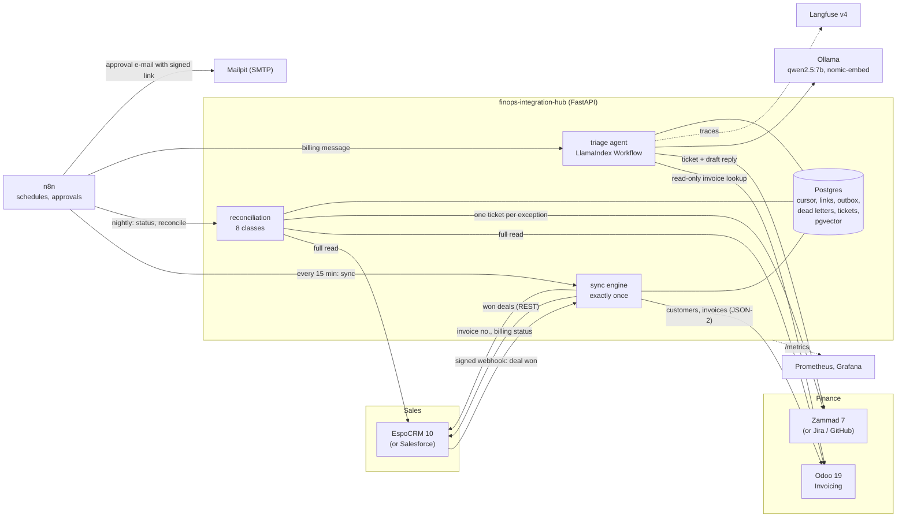

# Architecture

## The three jobs

**Sync** (`src/hub/sync/engine.py`, ADR 0003). Closed-won deals become posted invoices exactly once. The ERP is the
source of truth for "already invoiced" (each invoice's source document is `crm:<deal id>`), so a crash anywhere
heals on the next run; a Postgres advisory lock allows one run per CRM; CRM write-backs go through an outbox; deals
that need a person go to the dead-letter table with the reason. Accounts are processed in parallel, each account's
deals on one thread, so its ERP customer is created once. Triggered by EspoCRM's signed webhook (seconds) and by
n8n every 15 minutes (the safety net when a webhook is missed).

**Reconciliation** (`src/hub/recon/`). A full read of both systems compared by pure functions: missing,
cancelled and duplicate invoices, amount and currency mismatches, orphan invoices, duplicate customers, billing
status drift. Each exception has a fingerprint; the router keeps one ticket open per fingerprint and closes it
when a later run no longer finds it (ADR 0004). n8n runs it nightly after writing billing status back.

**Triage** (`src/hub/triage/`, ADR 0006). A LlamaIndex Workflow: a TF-IDF classifier answers when confident, else
the local LLM with retrieved labelled examples; billing intents look up the invoice numbers written in the message
(read-only); the LLM drafts a reply citing help-centre articles; refunds above 500 are held for approval by code,
and n8n e-mails finance a signed approve/reject link. Every turn is a Langfuse trace.

## Where state lives

| Store | Holds |
|---|---|
| Odoo | customers, invoices, payments (source of truth for money) |
| EspoCRM | accounts and deals (source of truth for what was sold) |
| Zammad | the tickets people work |
| hub Postgres | sync cursor, deal-invoice links, write-back outbox, dead letters, reconciliation runs and exceptions, ticket links, triage runs and approvals, webhook delivery digests, the two pgvector indexes |
| n8n Postgres | workflows, credentials (encrypted), executions, waiting approvals |
| Langfuse (Postgres + ClickHouse + MinIO) | traces |

One Postgres server holds every database locally (a login per system, none can read another's); production would
separate them.

## Security, briefly (ADR 0005)

Least-privilege integration users in Odoo, EspoCRM and Zammad; API keys hashed in memory and compared in constant
time; HMAC-verified webhooks with replay drop; header-authenticated n8n webhooks; signed n8n resume links;
Idempotency-Keys on triage; the LLM has no write tool and its output is data. Secrets are generated locally
(`make env`), git-ignored, and gitleaks runs before every push and in CI.
